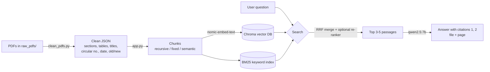

# RBI Circulars RAG Chatbot

Ask questions about RBI circulars. Answers come only from the PDFs, with citations [1], [2].
Everything runs locally with Ollama (embeddings: nomic-embed-text, chat: qwen2.5:7b): no API key needed.

## How it works



1. **Clean**: every PDF becomes clean sections (headings, tables as sentences, footnotes), with its
   title, circular number, issue date and whether it is an old (superseded) version.
2. **Chunk**: sections are cut into chunks; each chunk keeps its file, page and heading.
3. **Search**: vector search (meaning) + BM25 (exact words, circular numbers), merged; old circulars
   are hidden unless the question asks for them.
4. **Answer**: the local model answers ONLY from the passages and cites them as [1], [2].

## Files

| File | What it does |
|---|---|
| `clean_pdfs.py` | PDFs in `raw_pdfs/` -> clean JSON in `output/json/` |
| `app.py` | JSON -> chunks (recursive, fixed, semantic) -> vector databases in `vector_db/` |
| `streamlit_app.py` | Chat UI (only opens the databases, never builds them) |
| `eval.py` | Hit-rate, MRR, doc hit-rate, no-answer check -> `eval_results.csv` |
| `qa_test_set.csv` | **The Q&A test set** (Day 1 deliverable) used by `eval.py` - in the repo root |
| `check_corpus.py` | Chunks per file / type, short chunks, long headings, wrong titles |
| `rename_pdfs.py` | Gives the PDFs clean names (the file name is shown to users as the source) |

### Q&A test set (`qa_test_set.csv`)
Tab- or comma-separated, columns in this order:
`id | question | expected_answer | source_doc_id | file_name | page | answer_type | notes`
- `page` can be `2, 5` (hit if any of these pages is retrieved)
- `answer_type = no_answer` for out-of-scope questions (the bot must say it could not find it)
- `source_doc_id` = the PDF's content fingerprint (first 12 characters of its SHA-256). It does **not** change
  when a PDF is renamed, so renaming never breaks the test set. `python eval.py --ids` lists the doc_id of every file.
- Edit it in Notepad / VS Code. Do NOT 'Save as CSV' in Excel: that breaks the file (eval.py stops and says so)
- `file_name` is matched too (used when `source_doc_id` is empty)
- 40 questions on 28 documents: 27 paragraph, 6 list, 5 table, 2 multi-section. Several ask about
  near-identical documents (the Internal Ombudsman directions for Payments Banks / Small Finance Banks /
  Commercial Banks / CIC / NBFC) and use other words than the PDF, so the right FILE must win.

## Setup (one time)

1. Install Ollama (https://ollama.com), then:
   ```
   ollama pull nomic-embed-text
   ollama pull qwen2.5:7b
   ```
2. Install Python libraries:
   ```
   python -m venv .venv
   .venv\Scripts\activate          (Windows)   |   source .venv/bin/activate   (Linux/Mac)
   pip install -r requirements.txt
   ```
3. OCR (optional, for scanned pages) - see **OCR setup** below.

## OCR setup (scanned pages)

Some PDFs have scanned pages (pictures of text). `clean_pdfs.py` reads them with
**OCRmyPDF**, which needs two system programs: **Tesseract** (reads the text) and
**Ghostscript** (rewrites the PDF). Without them those pages stay empty and
`clean_pdfs.py` prints `WARNING: pages [...] need OCR - missing: ...`.

**Windows**
1. Tesseract: install from https://github.com/UB-Mannheim/tesseract/wiki
   (tick "Add to PATH", or add `C:\Program Files\Tesseract-OCR` to PATH yourself).
2. Ghostscript: install the 64-bit "AGPL release" from https://ghostscript.com/releases/gsdnld.html
   (adds `gswin64c`; if not found, add `C:\Program Files\gs\gs10.xx\bin` to PATH).
3. In the venv: `pip install ocrmypdf`
4. Close and reopen the terminal (so PATH is reloaded).

**Ubuntu / Debian:** `sudo apt install ocrmypdf tesseract-ocr ghostscript`
**macOS:** `brew install ocrmypdf` (installs Tesseract and Ghostscript too)

**Check** (each must print a version):
```
tesseract --version
gswin64c --version        (Windows)   |   gs --version   (Linux/Mac)
ocrmypdf --version
```
Then clean the PDFs again: `python clean_pdfs.py --force`

## Run (first time)

```
python clean_pdfs.py             # 1. PDF -> clean JSON
python app.py                    # 2. build all 3 databases (semantic is slow: do not stop it)
python check_corpus.py           # 3. check the corpus
streamlit run streamlit_app.py   # 4. chat at http://localhost:8501
```

Build only one strategy: `python app.py --strategy=fixed`
Force a full rebuild:   `python app.py --rebuild`

## Clean PDF names (before a demo)

The PDF file name is shown to users as the source, so give the files clear names:
```
python rename_pdfs.py            # writes rename_map.csv with suggested names - check / edit it
python rename_pdfs.py --apply    # renames the PDFs in raw_pdfs/
python clean_pdfs.py             # removes old outputs, cleans the renamed files
python app.py --rebuild
```
`qa_test_set.csv` keeps working (it finds documents by `source_doc_id`). Updating `file_name` is optional.

## Adding new PDFs

1. Copy the new PDFs into `raw_pdfs/` (with a clear file name)
2. `python clean_pdfs.py`  (only new or changed PDFs are cleaned)
3. `python app.py`  (sees the documents changed and rebuilds the databases)
4. Restart Streamlit (stop it with Ctrl+C, then run it again)

## Document types and versions

`clean_pdfs.py` types each document from page 1: `annual_report`, `faq`, `rbi_circular`,
`manual` or `general`. Only `rbi_circular` needs a circular number and issue date
(warnings are printed when they are missing).
A circular is marked old (`is_latest = false`) when another circular says it supersedes it
**by circular number** (RBI/2019-20/45, DBR.BP.BC.No.45/21.04.048/2024-25) or **by a dated
reference** ("circular ... dated July 1, 2019"), or when it carries a "Withdrawn/Superseded" stamp.

Annual reports and financial results are left out of the index (`INCLUDE_ANNUAL_REPORTS = False`
in `app.py`), because the bot is for RBI circulars.

## Sidebar options

- **Chunking strategy**: which database to search (recursive / fixed / semantic)
- **Hybrid search** (on by default): vectors (meaning) + BM25 (exact words, circular numbers)
- **Re-ranker**: fetch 20 chunks, keep the best 5 (better, a bit slower)
- **Query rewriting**: turns short/unclear questions into a clear search query
- **Show retrieved text**: shows the chunk text behind each source (for checking)

Each browser tab keeps its own settings.

## Evaluation

```
python eval.py --strategy=recursive                               # baseline
python eval.py --strategy=recursive --hybrid                      # + BM25
python eval.py --strategy=recursive --hybrid --rerank             # + re-ranker
python eval.py --strategy=recursive --hybrid --rerank --rewrite   # + query rewriting
python eval.py --all                                              # recursive + fixed + semantic -> eval_details_all.csv
python eval.py --all --setups                                     # 3 strategies x (base, hybrid, hybrid+rerank): 9 runs
python eval.py --report                                           # eval_report.md: before/after table
```
Repeat with `--strategy=fixed` and `--strategy=semantic` to compare chunking.

- **Fair comparison:** every setup is scored at the **same k** (default 5: Hit@1, Hit@3, Hit@5,
  MRR@5), even though the chatbot answers from 3 sources (5 with the re-ranker). Change with `--k=`.
- Every run adds one row to `eval_results.csv` **with its settings** (strategy, chunk size, k,
  models, MIN_RELEVANCE, test file + md5) and writes `eval_details_<setup>.csv`.
- `python eval.py --report` writes `eval_report.md`: every setup with its change vs. the baseline
  of the same chunking strategy. This is the before/after evidence for the improvements.
- **MIN_RELEVANCE:** the suggested cut-off is tuned on half of the questions (1, 3, 5, ...) and
  checked on the other half, so it is not tuned on the questions it is judged on.
- `--ragas` (faithfulness, answer relevance) needs a separate Python 3.12 venv with
  `pip install ragas datasets`. **Note:** RAGAS is graded by the same chat model that writes the
  answers (`chat_model` column), so treat those two scores as rough.

## Results

Scored on `qa_test_set.csv` (40 questions, 28 documents), same k = 5 for every setup.
The full table with the change against the baseline is in [`eval_report.md`](eval_report.md).

| Setup | Hit@1 | Hit@3 | Hit@5 | MRR@5 | Right document @5 |
|---|---|---|---|---|---|
| recursive (baseline) | _fill in_ | | | | |
| recursive + hybrid | | | | | |
| recursive + hybrid + rerank | | | | | |

_(Copy the numbers from `eval_report.md` after running `python eval.py --all --setups` and `python eval.py --report`.)_

## Demo


_(Record a short screen video of a question and its answer with sources, save it as `docs/demo.gif`.)_

## Deployment

The chatbot runs **fully on your own computer** with Ollama: no API key, no internet, and no document
or question leaves the PC. That is a deliberate choice for RBI documents.

Because the models run in Ollama on the local machine, the app cannot be opened from another computer
as it is. To make it available to others:
- **Server with Ollama**: a cloud or office server (16 GB RAM or more) with Ollama, the two models and
  this project; run `streamlit run streamlit_app.py --server.address 0.0.0.0` and open port 8501.
- **Hosted model API**: replace `ChatOllama` / `OllamaEmbeddings` in `app.py` with a hosted provider;
  then it can run on Streamlit Community Cloud (documents and questions are then sent to that provider).

## Do not commit

`vector_db/`, `output/`, `raw_pdfs/`, `.venv/`, `.env` (already in `.gitignore`).
**Do commit** `qa_test_set.csv`, `eval_results.csv`, `eval_details_*.csv` and `eval_report.md`, so others can check and
reproduce the evaluation.