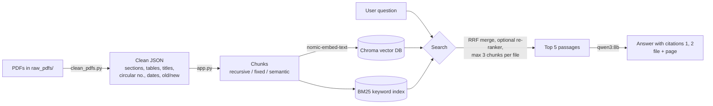

# RBI Circulars RAG Chatbot

Ask questions about RBI circulars, directions and FAQs. Answers come **only** from the PDFs, with a
citation ([1], [2]) and the file + page of every source. Old (withdrawn / superseded) circulars are
hidden unless the question asks for them.

Everything runs **locally** with Ollama: search model `nomic-embed-text`, chat model `qwen3:8b`
("thinking" switched off). No API key, and no question or document leaves the PC.


## How it works



1. **Clean** (`clean_pdfs.py`): every PDF becomes sections (headings, tables as sentences,
   footnotes), with its title, circular number, issue date, latest "Updated as on" date, document
   type, and whether it is an old version (a "Withdrawn" stamp, or another circular that supersedes
   it by exact circular number).
2. **Chunk** (`app.py`): sections are cut into chunks of about 1,000 characters. Each chunk keeps its
   file, pages and heading. There is one database per chunking strategy.
3. **Search**: vector search (meaning) + BM25 (exact words and circular numbers), merged with
   Reciprocal Rank Fusion. Optional cross-encoder re-ranker and query rewriting. Follow-up questions
   are rewritten from the last 3 turns.
4. **Answer**: the model answers ONLY from the 5 passages and cites them. When it cannot find the
   answer it says "I could not find this in the documents" and shows no sources.

## Files

| File | What it does |
|---|---|
| `clean_pdfs.py` | PDFs in `raw_pdfs/` -> clean JSON in `output/json/` |
| `app.py` | JSON -> chunks -> vector databases in `vector_db/`; retrieval and answers |
| `streamlit_app.py` | Chat UI (only opens the databases, never builds them) |
| `eval.py` | Retrieval and answer evaluation, baseline, report |
| `check_corpus.py` | Chunks per file / type, short chunks, long headings, wrong titles |
| `qa_test_set.csv` | Main test set: 40 answerable + 10 out-of-scope questions |
| `qa_heldout.csv` | Held-out test set: 16 answerable + 4 out-of-scope questions, never used for tuning |
| `tests/test_logic.py` | 39 fast tests of the logic (no Ollama needed) |
| `eval_report.md`, `eval_results.csv`, `eval_details_*.csv` | Evaluation results (see below) |
| `requirements.txt` | Python libraries |

## Setup (one time)

Tested with **Python 3.12** on Windows 11.

1. Install Ollama (https://ollama.com), then download the two models:
   ```
   ollama pull nomic-embed-text
   ollama pull qwen3:8b
   ```
2. Python libraries:
   ```
   py -3.12 -m venv .venv
   .venv\Scripts\activate          (Windows)   |   source .venv/bin/activate   (Linux/Mac)
   python -m pip install -r requirements.txt
   ```
3. Put the PDFs in `raw_pdfs/` (they are not in the repository).
4. OCR (optional, for scanned pages): see [OCR setup](#ocr-setup-scanned-pages).

> On a company PC where Device Guard blocks `.exe` files inside `.venv`, start every tool through
> Python: `python -m pip`, `python -m streamlit`, `python -m pytest`.

## Run

```
python clean_pdfs.py                          # 1. PDF -> clean JSON (only new / changed PDFs)
python app.py                                 # 2. build all 3 databases (semantic is slow: do not stop it)
python check_corpus.py                        # 3. check the corpus (files, types, short chunks, titles)
python -m streamlit run streamlit_app.py      # 4. chat at http://localhost:8501
python -m pytest tests -q                     #    logic tests (no Ollama needed)
```
One strategy only: `python app.py --strategy=recursive`. Full rebuild: `python app.py --rebuild`.
Clean all PDFs again: `python clean_pdfs.py --force`.

### Sidebar options

- **Chunking strategy**: which database to search (only the built ones are listed)
- **Hybrid search** (on by default): vectors + BM25 (exact words, circular numbers)
- **Re-ranker**: re-orders the 20 candidates with a cross-encoder (downloads ~90 MB the first time)
- **Query rewriting**: turns short / unclear questions into a clear search query
- **Show retrieved text**: shows the chunk text behind each source

Each browser tab keeps its own settings.

## Test sets

Tab-separated: `id | question | expected_answer | source_doc_id | file_name | page | answer_type | notes`

- `page` can be `2, 5`: a hit if any of these pages is retrieved.
- `answer_type = no_answer`: out of scope; the bot must answer "I could not find this in the documents".
- `source_doc_id` = the PDF's content fingerprint (first 12 characters of its SHA-256). It does not
  change when a PDF is renamed. `python eval.py --ids` lists them.
- Edit the files in Notepad / VS Code, **not Excel** ("Save as CSV" in Excel breaks them; eval.py
  stops and says so).

**`qa_test_set.csv`** (50): 27 paragraph, 6 list, 5 table and 2 multi-section questions, plus 10
`no_answer` questions: 3 off-topic, 2 plausible-but-absent banking topics and 5 near-misses (the topic
is in the documents but the number asked for is not). Several questions ask about near-identical
documents (the Internal Ombudsman directions for Payments Banks / Commercial Banks / CIC) in other
words than the PDF. Six questions are about withdrawn circulars and say so ("Under the withdrawn ..."),
to test the old-version filter.

**`qa_heldout.csv`** (20): 11 paragraph, 4 list and 1 multi-section question plus 4 `no_answer`.
Written after all tuning, only on documents and facts the main set does not use (Small Finance Bank,
NBFC and CIC directions, policy rates, deposits, bulletin, LAB and RRB KYC directions), and never used
to change any setting.

### Additional test cases

<!-- Add your extra test sets here, for example: -->

| File | Questions | Written by | Notes |
|---|---|---|---|
| `TEST_FILE_HERE.csv` |  |  |  |

Run any test file with `python eval.py --strategy=recursive --hybrid --test=TEST_FILE_HERE.csv`,
then `python eval.py --report`.

## Evaluation

```
python eval.py --bm25-pages                                    # the floor: plain BM25 over whole pages
python eval.py --bm25-pages --test=qa_heldout.csv
python eval.py --strategy=recursive                            # vectors only (baseline)
python eval.py --strategy=recursive --hybrid                   # the chatbot's default setup
python eval.py --strategy=recursive --hybrid --test=qa_heldout.csv
python eval.py --report                                        # eval_report.md + the table below
```

- **Same k for every setup** (Hit@1, Hit@3, Hit@5, MRR@5). The bot answers from 5 passages.
- **Hit** = the right document AND one of the expected pages is in the top k.
- **Key facts** = share of the numbers, amounts, dates and e-mail addresses of the expected answer
  that appear in the bot's answer.
- **No-answer refused** = share of out-of-scope questions where the bot correctly said it could not
  find the answer.
- Every run adds a row with all its settings to `eval_results.csv` and writes
  `eval_details_<test>_<setup>.csv` (every question: hit or miss, rank, the bot's answer).
- More setups: `python eval.py --all --setups` (3 strategies × 4 setups + 3 ablation rows).
  `--retrieval-only` skips the answers (fast).

### Results

Scored at k = 5. Model: `qwen3:8b` on a laptop CPU, about 35 seconds per answer.

<!-- RESULTS:START -->
| Test set | Setup | Hit@1 | Hit@3 | Hit@5 | MRR@5 | Key facts | No-answer refused |
|---|---|---|---|---|---|---|---|
| qa_test_set.csv | `bm25-pages` | 0.575 | 0.775 | 0.800 | 0.676 |  |  |
| qa_test_set.csv | `recursive` | 0.725 | 0.850 | 0.875 | 0.784 | 0.685 | 0.900 |
| qa_test_set.csv | `recursive+hybrid` | 0.750 | 0.875 | 0.900 | 0.810 | 0.749 | 1.000 |
| qa_heldout.csv | `bm25-pages` | 0.438 | 0.688 | 0.750 | 0.568 |  |  |
| qa_heldout.csv | `recursive` | 0.562 | 0.812 | 0.812 | 0.677 |  |  |
| qa_heldout.csv | `recursive+hybrid` | 0.562 | 0.750 | 0.750 | 0.656 | 0.762 | 1.000 |
<!-- RESULTS:END -->

Full table with per-question wins and losses: [eval_report.md](eval_report.md).

**What the numbers say**

1. **Chunking beats whole pages.** Both setups beat plain BM25 over whole pages on both test sets
   (main set Hit@5: 0.800 -> 0.875 / 0.900; held-out Hit@1: 0.438 -> 0.562).
2. **Hybrid search helps a little on the main set, not on the held-out set.** On the main set it
   finds one more question (q027) and loses none. On the held-out set it loses one (h03: right
   document, wrong page). With 40 and 16 questions, one question is 2.5 and 6.25 points, so the
   difference is small.
3. **Refusals are good.** With hybrid search the bot refused all 14 out-of-scope questions
   (10 + 4). With vectors only it answered one near-miss (q047).
4. **Answers are scored only for the default setup** (recursive + hybrid, plus the vectors-only
   baseline on the main set), because each answer takes about 35 seconds on a CPU. The held-out
   vectors-only row is retrieval only.

**Where it still fails**

- **Different words in the question and the PDF:** q012 asks for a "penalty"; the PDF says "fine".
- **Right document, wrong page** in long, near-identical documents: h03 (Small Finance Bank
  ombudsman tenure), h12 (Authorised Person definition), q027 (capital ratios).
- **Two documents are never found:** the BEAWARE fraud booklet (q016, q017, h15) and the Local Area
  Bank directions (q026, h13). The booklet is printed on background pictures and the LAB file is
  nearly identical to the RRB directions; both should be checked with `check_corpus.py`.

**With another week**

A larger held-out set written by someone else, scoring by section instead of page, a stronger judge
for answer correctness than key-fact matching, and the full `--all --setups` comparison on a faster
machine.

## Documents and versions

`clean_pdfs.py` types each document from page 1: `annual_report`, `faq`, `rbi_circular`, `manual` or
`general`. Only `rbi_circular` needs a circular number and issue date (warnings are printed when they
are missing). Consolidated master directions also get `updated_on` (the latest "Updated as on" date),
and the model is told to prefer the most recent document.

A circular is **old** (`is_latest = false`) when it carries a "Withdrawn" / "Superseded" stamp, or when
another circular supersedes it by **exact** circular number or by a dated reference. Old circulars are
searched only when the question names a circular number, a year with "circular / direction", or asks
for a withdrawn / superseded / earlier circular. A bare "withdrawn" ("Is the Rs 2000 note withdrawn?")
does not count.

Annual reports of banks and their financial results are left out of the index
(`INCLUDE_ANNUAL_REPORTS = False`). RBI's own Annual Report chapter is kept (decided from the cover
page, not the file name).

## Adding or renaming PDFs

1. Copy the new PDFs into `raw_pdfs/` with a clear file name (the file name is shown to users as the
   source).
2. `python clean_pdfs.py`, then `python app.py` (it sees the change and rebuilds).
3. Restart Streamlit. The test sets keep working after renames (`source_doc_id`).

## OCR setup (scanned pages)

Some PDFs have scanned pages (pictures of text). `clean_pdfs.py` reads them with **OCRmyPDF**, which
needs **Tesseract** (reads the text) and **Ghostscript** (rewrites the PDF). Without them those pages
stay empty and `clean_pdfs.py` prints `WARNING: pages [...] need OCR - missing: ...`.

**Windows**
1. Tesseract: install from https://github.com/UB-Mannheim/tesseract/wiki
   (tick "Add to PATH", or add `C:\Program Files\Tesseract-OCR` to PATH yourself).
2. Ghostscript: install the 64-bit "AGPL release" from https://ghostscript.com/releases/gsdnld.html
   (adds `gswin64c`; if not found, add `C:\Program Files\gs\gs10.xx\bin` to PATH).
3. In the venv: `python -m pip install ocrmypdf`
4. Close and reopen the terminal.

**Ubuntu / Debian:** `sudo apt install ocrmypdf tesseract-ocr ghostscript`
**macOS:** `brew install ocrmypdf`

Check: `tesseract --version`, `gswin64c --version` (Windows) or `gs --version`, `ocrmypdf --version`.
Then clean the PDFs again: `python clean_pdfs.py --force`

## Deployment

The chatbot runs **locally only**. It needs Ollama with `qwen3:8b` (about 5 GB) and
`nomic-embed-text`, and free hosting services do not offer a machine that can run them. To show it
to others, run it on your PC (`python -m streamlit run streamlit_app.py`) or watch the
[demo video](#demo).

## Do not commit

`raw_pdfs/`, `vector_db/`, `output/`, `.venv/`, `.env` (all in `.gitignore`).
**Do commit** `qa_test_set.csv`, `qa_heldout.csv`, `eval_results.csv`, `eval_details_*.csv` and
`eval_report.md`, so others can check and reproduce the evaluation.